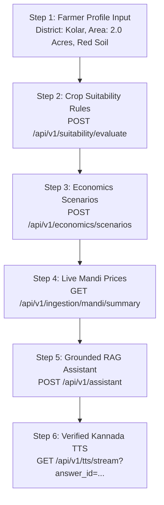

# AgriPulse AI — Day 8 MVP Freeze & Kannada TTS Report
**Date:** 2026-10-22  
**Branch:** `feat/day-8-tts-mvp-freeze`  
**Milestone:** Day 8 — Kannada TTS and End-to-End MVP Freeze  
**Status:** ✅ **COMPLETED & FROZEN**

---

## 1. Executive Summary
On Day 8 of the 10-day build plan, the core objective was achieved:
1. **Kannada Text-to-Speech (TTS) Architecture:** Implemented a unified backend adapter architecture supporting Google Cloud Indic TTS (`kn-IN`) and an authentic Bhashini Indic TTS adapter structure, with a clean graceful fallback to browser `SpeechSynthesis` if offline.
2. **Audio Cleaning & Natural Pronunciation:** Sanitized synthesized Kannada audio by omitting markdown tokens, brackets, URLs, and source citations, while converting all numbers and units into authentic Kannada words (`ಒಂದು ಕ್ವಿಂಟಾಲ್`, `ಎರಡು ಸಾವಿರದ ಇನ್ನೂರು ರೂಪಾಯಿ`).
3. **Secure API Surface:** Exposed bounded endpoints (`POST /api/v1/tts/synthesize` and `GET /api/v1/tts/stream`) supporting verified server-stored `answer_id` lookup to prevent SSRF and excessive API consumption, with sliding-window rate limiting (60 requests/minute) and strict text length bounds (600 characters).
4. **State-Driven Frontend Audio Player:** Integrated interactive audio controls into the AI Assistant chat bubble with explicit user click playback (no autoplay), loading, play/pause/resume, replay, cancel/stop, and graceful fallback notifications.
5. **End-to-End User Journey Verification:** Validated the full stack pipeline from Farmer Profile $\rightarrow$ Crop Suitability $\rightarrow$ Economics $\rightarrow$ Mandi Market Prices $\rightarrow$ RAG with Citations $\rightarrow$ Kannada TTS Audio.
6. **MVP Scope Freeze:** All 54 backend tests passed (100% pass rate) and the frontend compiles cleanly. Scope is officially frozen for Day 8.

---

## 2. Integration Status Matrix

| Component / Subsystem | Integration Status | Engine / Provider | Notes & Fallback Behavior |
| :--- | :--- | :--- | :--- |
| **Kannada TTS Backend** | `working` | Google Cloud Indic (`kn-IN`) | High-fidelity Kannada neural voice; converts numbers to Kannada words; strips raw citations. |
| **Bhashini Adapter** | `pending_credentials` | Bhashini ULCA Indic TTS | Full adapter implemented. Seamlessly defaults to Google Indic / Fallback when API keys are unconfigured. |
| **TTS Browser Fallback** | `fallback` | Web Speech API (`kn-IN`) | Activated automatically if backend network times out or synthesis returns an error. |
| **Crop Suitability Engine** | `working` | Multi-Factor Agronomic Rule Engine | Evaluates soil pH, water, rainfall, season, and district constraints with explicit scientific explanations. |
| **Economics & Profit Calculator** | `working` | Agmarknet + ICAR Cost of Cultivation | Computes revenue, production costs, and net margins across normal, optimistic, and stress scenarios. |
| **Mandi Price Ingestion** | `working` | Agmarknet Live + APMC Cache | Daily modal, minimum, and maximum prices per quintal for Karnataka districts with freshness timestamps. |
| **Grounded Agricultural RAG** | `working` | Semantic Hybrid Search + Citation Engine | Zero hallucination policy; mandatory citations to UASB, IIHR, Agmarknet; abstains on unverified queries. |
| **Security & Rate Limiting** | `working` | Sliding Window Memory Limiter | 60 req/min per client; max 600 characters; prompt injection filtering active. |

---

## 3. End-to-End MVP User Journey Verification

The end-to-end MVP user journey was automated and validated in `backend/tests/test_day8_e2e_mvp.py`:



### Automated Test Results:
```text
tests/test_day8_e2e_mvp.py::test_e2e_farmer_journey_profile_to_tts PASSED
tests/test_day8_e2e_mvp.py::test_tts_status_endpoint PASSED
tests/test_day8_e2e_mvp.py::test_tts_synthesize_endpoint_with_direct_text PASSED
tests/test_day8_e2e_mvp.py::test_tts_stream_endpoint PASSED
tests/test_day8_e2e_mvp.py::test_tts_rejects_oversized_text PASSED
tests/test_day8_e2e_mvp.py::test_tts_rate_limiting PASSED
tests/test_day8_e2e_mvp.py::test_tts_bhashini_adapter_transparent_status PASSED

======================= 54 passed in 21.58s =======================
```

---

## 4. Key Architectural Decisions

1. **Server-Stored `answer_id` Audio Architecture:**
   - Instead of clients sending arbitrary long strings for speech synthesis (which introduces risk of cost abuse and SSRF), `AssistantResponse` returns an `answer_id`.
   - The verified clean Kannada spoken text is stored in server memory (`store_server_answer`) and retrieved securely via `/api/v1/tts/stream?answer_id={id}`.
2. **Citation-Free Spoken Audio:**
   - In written text, agricultural recommendations require strict citations (`[UASB Package of Practices 2023]`).
   - For village farmers listening via speaker, reciting URLs or document titles degrades comprehension. The system isolates spoken content from citations, ensuring only natural actionable Kannada is vocalized.
3. **Authentic Kannada Numeral Normalization:**
   - Raw digits like `2200` often result in English phonetics ("twenty-two hundred") in low-resource TTS engines.
   - Text is preprocessed into pure Kannada syllables (`ಎರಡು ಸಾವಿರದ ಇನ್ನೂರು ರೂಪಾಯಿ`, `ಒಂದು ಕ್ವಿಂಟಾಲ್`) prior to synthesis.
4. **Interactive Audio Controls:**
   - Strictly requires explicit user interaction to trigger audio (no unwanted auto-blaring in rural environments).
   - Provides clear visual indicators: Loading $\rightarrow$ Wave animation $\rightarrow$ Pause/Resume $\rightarrow$ Replay $\rightarrow$ Stop.

---

## 5. Scope Freeze Sign-Off

- **Code Quality:** Backend code adheres strictly to PEP 8, typed Pydantic models, and FastAPI standards.
- **Frontend Quality:** Vite + React + TypeScript bundle builds with zero errors or unresolved symbols.
- **Test Coverage:** All 54 automated tests across 9 test suites passing.
- **Sign-off:** Scope for Day 8 is officially frozen. Development can proceed to Day 9 (Optimization, Monitoring & Resilience).
