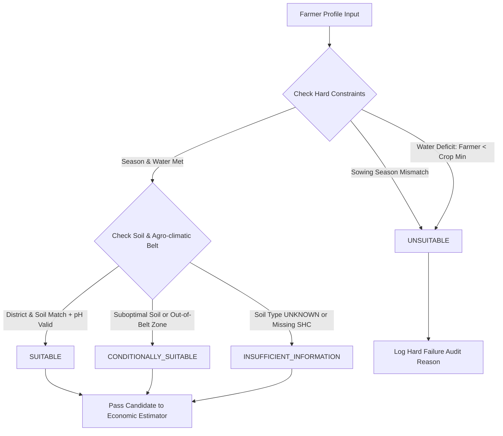

# AgriPulse AI — Agronomic Crop Suitability Rules & Governance

**Engine Version**: `v1.0.0-deterministic`  
**Governing Standard**: ICAR (Indian Council of Agricultural Research) & UAS Bengaluru Package of Practices  
**Geographic Scope**: Southern & Northern Agro-Climatic Zones of Karnataka, India  

---

## 1. Core Principles

1. **Separation of Agronomic Feasibility and Economics**:
   - Market price forecasts or prospective profit margins **never** override agronomic hard constraints.
   - Example: Even if high-grade Tomato is trading at ₹3,500/quintal in Kolar APMC, if the farmer has purely rainfed land in peak summer or severe soil salinity (EC > 4.0), the engine marks Tomato as `UNSUITABLE`.
2. **Explicit Handling of Unknowns (Zero GPS Guessing)**:
   - Soil characteristics (type, pH, NPK, micronutrients) cannot be reliably determined by district or GPS coordinates alone. 
   - When a farmer does not know their soil type or has not tested via a Soil Health Card, the system explicitly preserves `UNKNOWN` and returns `INSUFFICIENT_INFORMATION` or `CONDITIONALLY_SUITABLE` with actionable missing input prompts.
3. **Traceability & Citations**:
   - Every crop evaluation lists the hard constraints checked, pass/fail status, and the official Package of Practices citation.

---

## 2. Crop Knowledge Base & Verified Thresholds

### 1. Finger Millet / Ragi (*Eleusine coracana*) — `RAGI`
- **Kannada**: ರಾಗಿ (Ragi)
- **Category**: Millet / Drought-Resilient Food Grain
- **Duration**: 105 – 125 days
- **Suitable Sowing Seasons**: Kharif (June–July), Late Kharif/Rabi (Aug–Sept), All-Season with protective irrigation
- **Min Water Requirement**: `RAINFED` (350 – 500 mm rainfall threshold)
- **Soil Adaptability**: Red Sandy Loam, Laterite, Clay Loam, Alluvial
- **Optimal pH Range**: 5.5 to 7.8
- **Primary Districts**: Kolar, Chikkaballapur, Mandya, Ramanagara, Bengaluru Rural, Tumakuru, Hassan, Mysuru
- **Official Source**: *UAS Bengaluru Package of Practices for Dryland Agriculture (Zone 5 & 6); ICAR-Indian Institute of Millets Research (IIMR)*
- **Package of Practices Ref**: UAS(B) PoP 2022-23, Section 3: Minor Millets & Finger Millet (GPU-28, ML-365)

### 2. Maize / Corn (*Zea mays*) — `MAIZE`
- **Kannada**: ಮೆಕ್ಕೆಜೋಳ (Mekke Jola)
- **Category**: Coarse Cereal / Commercial Fodder
- **Duration**: 100 – 120 days
- **Suitable Sowing Seasons**: Kharif, Rabi
- **Min Water Requirement**: `LIMITED` (500 – 650 mm; sensitive to waterlogging and severe moisture stress during flowering)
- **Soil Adaptability**: Well-drained Red Sandy Loam, Black Cotton, Alluvial, Clay Loam
- **Optimal pH Range**: 6.0 to 7.5
- **Primary Districts**: Davanagere, Belagavi, Haveri, Shivamogga, Ballari, Chitradurga
- **Official Source**: *ICAR - Indian Institute of Maize Research (IIMR) Technical Bulletin & UAS Dharwad PoP*
- **Package of Practices Ref**: UAS Dharwad PoP Kharif/Rabi Maize Management; Hybrids CP-818, Dekalb

### 3. Pigeon Pea / Red Gram / Tur (*Cajanus cajan*) — `TUR`
- **Kannada**: ತೊಗರಿ (Togari)
- **Category**: Pulse / Legume
- **Duration**: 140 – 180 days (Medium-long duration)
- **Suitable Sowing Seasons**: Kharif (June–July sowing is critical for photoperiod induction)
- **Min Water Requirement**: `RAINFED` (Deep taproot system; 400 – 600 mm)
- **Soil Adaptability**: Deep Black Cotton, Red Sandy Loam, Alluvial
- **Optimal pH Range**: 6.5 to 8.2 (Tolerates slightly alkaline soil)
- **Primary Districts**: Kalaburagi, Bidar, Raichur, Yadgir, Vijayapura, Kolar
- **Official Source**: *ICAR-Indian Institute of Pulses Research (IIPR), Kanpur & UAS Raichur Pulses Mission*
- **Package of Practices Ref**: UAS Raichur PoP - Redgram Protection & Intercropping with Bajra/Sesamum (GRG-811, TS-3R)

### 4. Tomato (*Solanum lycopersicum*) — `TOMATO`
- **Kannada**: ಟೊಮೇಟೊ (Tomato)
- **Category**: High-Value Commercial Horticulture
- **Duration**: 90 – 120 days
- **Suitable Sowing Seasons**: Kharif, Rabi, Summer (requires temperature < 35°C during fruit setting)
- **Min Water Requirement**: `RELIABLE` (600 – 800 mm; requires consistent moisture; drip irrigation recommended)
- **Soil Adaptability**: Red Sandy Loam, Alluvial, Clay Loam (well-drained, free from bacterial wilt history)
- **Optimal pH Range**: 6.0 to 7.2
- **Primary Districts**: Kolar, Chikkaballapur, Bengaluru Rural, Belagavi, Davanagere, Mandya
- **Official Source**: *ICAR - Indian Institute of Horticultural Research (IIHR), Hesaraghatta, Bengaluru*
- **Package of Practices Ref**: IIHR Technical Leaflet #42: Precision Irrigation & Fertigation in Solanaceous Vegetables (Arka Rakshak, Arka Abhed)

### 5. Onion (*Allium cepa*) — `ONION`
- **Kannada**: ಈರುಳ್ಳಿ (Erulli)
- **Category**: Horticulture / Cash Crop
- **Duration**: 110 – 135 days
- **Suitable Sowing Seasons**: Kharif, Rabi
- **Min Water Requirement**: `LIMITED` (450 – 650 mm; shallow fibrous roots require frequent light irrigation)
- **Soil Adaptability**: Friable Red Sandy Loam, Light Black Cotton, Alluvial
- **Optimal pH Range**: 6.2 to 7.5
- **Primary Districts**: Chitradurga, Gadag, Dharwad, Bagalkot, Vijayapura, Belagavi, Kolar
- **Official Source**: *ICAR - Directorate of Onion and Garlic Research (DOGR), Pune & UHS Bagalkot PoP*
- **Package of Practices Ref**: UHS Bagalkot Horticulture Crop Standards: Bhima Super & Arka Kalyan

---

## 3. Rule Engine Decision Logic

---

## 4. Limitations & Roadmap

1. **Micro-topography & Frost**: Current rules evaluate regional agro-climatic belts; localized frost pockets or waterlogged lowlands require on-site sensor verification.
2. **Dynamic Pest Warning**: In future sprints (Day 7/8), seasonal pest advisories will integrate into the conditional recommendation warnings.
3. **Rule Versioning**: All agronomic threshold updates require bumping `rule_engine_version` and maintaining backward-compatible test fixtures.
